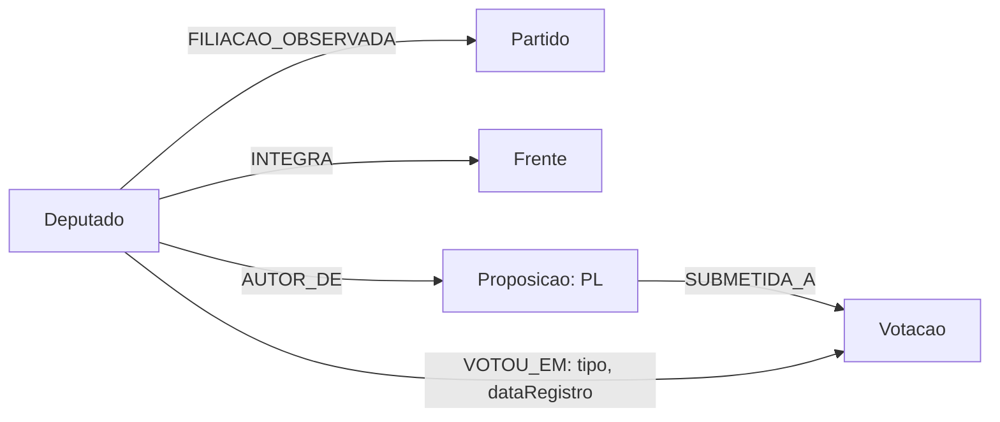

# Câmara dos Deputados em grafo

Projeto acadêmico para coletar dados públicos da Câmara, modelar relações entre deputados, partidos, frentes, projetos de lei, votações e votos, carregá-las no Neo4j e executar cinco análises em Cypher. O relatório e seus prints não estão incluídos.

## Pré-requisitos

Docker com Compose e acesso à internet para baixar imagens e consultar a API. O padrão usa a porta 7474 (Browser) e 7687 (Bolt); altere `compose.yaml` se estiverem ocupadas. Reserve memória para o Neo4j e espaço em disco para o snapshot e o volume.

## Execução

Use os scripts abaixo a partir de qualquer diretório (ajuste o caminho para a pasta do projeto):

```sh
./scripts/iniciar.sh
./scripts/coletar.sh
./scripts/importar.sh
```

Os scripts de coleta e importação constroem a imagem quando necessário e iniciam o Neo4j automaticamente. Para consultar os serviços, execute `./scripts/status.sh`; para encerrá-los preservando o volume, execute `./scripts/parar.sh`. Os argumentos de coleta e importação são encaminhados ao programa, incluindo `--help` e `--arquivo`.

Aguarde a conclusão de cada comando. A coleta pode levar bastante tempo, pois busca autores e votações de cada proposição e os membros de cada frente. Ela falha diante de erro persistente da API e só substitui o snapshot após a conclusão integral. Para testar com um recorte menor:

```sh
./scripts/coletar.sh --ano 2023 --legislatura 57 --limite-proposicoes 10 --limite-frentes 5
```

O padrão é ano de apresentação 2023, legislatura 57 e os primeiros 100 PLs ordenados por ID crescente; `--limite-proposicoes 0` seleciona todos os PLs do ano e pode demorar muito. As votações obtidas são todas as disponibilizadas para os PLs selecionados, sem filtro de data. Por padrão são incluídas todas as frentes; `--limite-frentes` permite um recorte menor na ordem retornada pela API. Frentes são aquelas criadas na legislatura informada; seus membros são os signatários registrados, não necessariamente membros atuais. Os parâmetros podem ser alterados e `--arquivo nome.json` é aceito por ambos os comandos. A coleta salva em `data/raw/snapshot.json` as respostas originais (listas `dados` da API) e metadados; preserve esse arquivo para entrega e reprodutibilidade. Ele é ignorado pelo Git devido ao tamanho. O recorte é determinístico para o estado da API no momento da coleta, mas dados públicos podem ser atualizados.

Abra <http://localhost:7474>, conecte em `bolt://localhost:7687` com usuário `neo4j` e senha `trabalho123`. Para alterar a senha antes da primeira inicialização, defina `NEO4J_PASSWORD` no ambiente ou num arquivo `.env` (exemplo em `.env.example`). O Neo4j conserva suas credenciais no volume; mudar a variável posteriormente não altera uma senha já criada.

A importação usa `MERGE`, restrições de unicidade e lotes: repetir a mesma carga não duplica entidades ou relações. Ela é **cumulativa**, não apaga dados ausentes de um novo snapshot e não é uma transação única. Para análises de um único recorte, use uma base vazia antes de importar outro. A remoção do volume abaixo apaga **todos** os dados e credenciais dessa instalação, mas preserva `data/raw`:

```sh
docker compose down -v
```

Para apenas parar os serviços sem apagar dados: `docker compose down`.

## Modelo



Os nós são identificados pelos IDs da API, exceto Partido, identificado pela sigla observada. `SUBMETIDA_A` representa a associação retornada pelo endpoint de votações de uma proposição; não implica que toda votação seja aprovação final do texto. Autores que não sejam deputados são excluídos. Alguns autores podem ter apenas ID e nome quando ausentes de outras respostas. Um deputado pode ter mais de uma `FILIACAO_OBSERVADA`, pois registros vêm de diferentes endpoints e momentos. Ela **não é histórico datado**, nem prova a filiação no momento do voto; usar cautela nas comparações por partido. As frentes identificam signatários da criação, sem comprovar atividade posterior. A API só publica votos individuais quando registrados; ausência de voto não significa ausência do deputado. Votos de obstrução ou outras modalidades ficam armazenados, mas as análises de concordância consideram apenas Sim e Não. As votações relacionadas podem ser anteriores ou posteriores ao ano de apresentação dos PLs.

## Consultas e interpretação

Cole cada bloco de [queries/analises.cypher](queries/analises.cypher) separadamente no Neo4j Browser. As cinco perguntas tratam de concordância entre integrantes de frentes de partidos diferentes, coautoria, concordância entre partidos, divergência dentro de frentes e concordância entre coautores nas votações compartilhadas do recorte. A contagem de comparações é por par de deputados e votação, não por votação única; deputados com múltiplas filiações observadas podem contribuir em mais de um par de partidos. Limiares reduzem resultados com pouquíssimas observações, mas não eliminam vieses. Alguns resultados podem ser vazios, especialmente em recortes pequenos; aumente o limite ou ajuste o período antes de concluir que não existe relação. Essas medidas são descritivas, não demonstram causalidade nem representam todas as atividades da Câmara.

[queries/inspecao.cypher](queries/inspecao.cypher) contém contagens, visualização limitada e consulta opcional do grafo completo. No Browser escolha Graph para a visualização; consultas completas podem exigir muita memória. As quantidades reais e período das votações dependem do snapshot, e devem ser apurados após a carga; não há números ou insights inventados neste repositório.

## Referências

Consulte a [documentação oficial da API](https://dadosabertos.camara.leg.br/swagger/api.html) e a [explicação sobre votações](https://dadosabertos.camara.leg.br/howtouse/2020-02-07-dados-votacoes.html) para o significado e limitações dos dados.

## Recorte do relatório

O relatório usa `data/raw/relatorio.json`, coletado em 24/11/2026, com 40 PLs de 2023 e 20 frentes da legislatura 57; o arquivo contém os dados originais desse recorte e está presente localmente, mas é ignorado pelo Git. `scripts/coletar_relatorio.py` registra como essa amostra foi coletada, incluindo chamadas paralelas e cache temporário. O conjunto pode mudar caso seja novamente obtido da API. Para reproduzir os resultados a partir do snapshot já salvo, importe-o em um banco vazio e execute:

```sh
./scripts/importar.sh --arquivo relatorio.json
./scripts/registrar_resultados.sh
```

O comando gera `output/resultados.json` com contagens, exemplos e os resultados das cinco consultas. A associação de proposições e votações foi mantida como retornada pela API: no recorte há votações anteriores ao ano informado das proposições. Isso requer investigação adicional e impede interpretar automaticamente essas relações como uma cronologia de votação do texto.
# trabalho-neo4j
